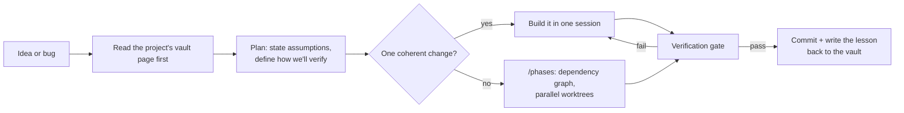

<div align="center">

# How I build with Claude Code

**The skills, commands and habits I use every day to ship real products with Claude Code.**




</div>

---

## Why this repo exists

I don't type most of my code by hand. I direct Claude Code, then I read what it wrote, test it and decide what ships. That only works if the process around the model is solid, so over time I turned the things I kept repeating into skills and commands.

This repo is that toolkit. Everything here is something I actually use on my own products ([Future Office](https://github.com/bumblebees002/future-office-showcase), [AI Accountant](https://github.com/bumblebees002/ai-accountant-showcase), [AI Shopkeeper](https://github.com/bumblebees002/ai-shopkeeper-showcase)). It's not a collection of prompts I found online.

## The workflow in one picture



## The rules I work by

1. **Read before you explore.** Every project has a page in my Obsidian vault. A session-start hook puts it into context, so Claude starts from what we already know (decisions, past bugs, open questions) and doesn't re-learn the repo from scratch.
2. **Plan with a verification step.** Before any non-trivial change: write down the assumptions, keep the change small, and decide up front how we'll prove it works. If something is unclear, stop and ask. Don't guess.
3. **One gate, run by one process.** Typecheck, lint, tests and build run one at a time by the orchestrator, never by parallel agents. A passing gate is necessary but not enough, so I also check the real behaviour (logs, the database, the live app).
4. **Agents don't commit.** Subagents write code. Only the orchestrator touches git, so worktrees never fight over `.git/index.lock`.
5. **Write the lesson down.** When a bug teaches something, it goes into the project's vault page, so the next session doesn't hit the same wall.
6. **Reuse before rebuild.** Before building a feature, check my private template library and a vetted list of open-source repos. Adapt what exists and credit it.

## Commands

### `/phases`: big plans as a dependency graph
[`commands/phases.md`](commands/phases.md)

For anything bigger than a handful of files. It scouts which files each phase touches, then:
- runs phases **in parallel** only if they share no files and don't depend on each other,
- gives each committing phase **its own git worktree**,
- breaks a phase that's too big for one agent into smaller pieces, at any depth,
- runs **one serialized verification gate** before each commit, then merges in dependency order.

Three rules hold it together: never nest agents, subagents never commit, subagents never run the full gate.

## Skills

| Skill | What it does |
|---|---|
| [`compact-prompt`](skills/compact-prompt) | Writes a ready-to-paste `/compact` command for the situation the session is in right now (a plan not started yet, agents mid-flight, a pivot, debugging). Compaction then keeps branch names, agent rosters and decisions instead of a vague summary. |
| [`template`](skills/template) | Before building a feature: search my template library, then a vetted repo list, then the open internet. Adapt what fits into this project instead of rewriting it. |
| [`templify`](skills/templify) | The other direction: breaks a finished project into features, judges which are reusable, and writes a harvest brief for each one. |
| [`proposal`](skills/proposal) | Reads a job post or client brief, decides whether it's worth bidding at all, and drafts the proposal only from evidence in my notes. It never invents a claim. |
| [`feature-ui-sample`](skills/feature-ui-sample) | Explores an app, then generates a gallery of new-feature ideas, each in a different visual style. One builder agent per sample, a grep gate, then reviewer agents. |
| [`vault`](skills/vault) | Reads and writes the project's Obsidian page: decisions, lessons, "why did we do it this way". This is the long-term memory across sessions. |
| [`tutor`](skills/tutor) | Teaches me an unfamiliar codebase skeleton-first, so I understand the shape before reading code. |
| [`artifact-to-html`](skills/artifact-to-html) | Recovers a standalone HTML file from a claude.ai artifact link using the local browser cache. |

## How I use them together

A normal feature day looks like this:

1. Open the project. The vault hook loads its page.
2. `/template`: does this feature already exist somewhere I trust?
3. Plan in plan mode. If it splits into independent parts, the plan includes a table of pieces (files, dependencies, what can run in parallel).
4. `/phases` runs the plan with worktrees and the gate.
5. Context getting long? `/compact-prompt` writes the compaction instructions so nothing important is lost.
6. Done: commit, then `/vault` records what we learned.

I also keep a second model on hand for a different opinion when I'm stuck on a bug, and I use a few community tools (credited below) alongside my own.

## Install

```bash
git clone https://github.com/bumblebees002/claude-code-workflow
cp -R claude-code-workflow/skills/* ~/.claude/skills/
cp claude-code-workflow/commands/* ~/.claude/commands/
```

`feature-ui-sample` reads design references from my private `ui` skill; without it, point it at your own style notes. Some skills expect an Obsidian vault. Set `OBSIDIAN_VAULT` to its path, or edit the paths in each `SKILL.md`.

## Credits

Tools I use alongside these, made by others and not included here: [graphify](https://github.com/Graphify-Labs/graphify) (knowledge graphs of a codebase), [GSD](https://github.com/gsd-build/get-shit-done) agents, Andrej Karpathy's coding guidelines as a skill, and the Composio CLI.

## About me

I'm Mohamed Adel, an AI product engineer in India. I build agents that work on real data, safely, and I build them with Claude Code.

[LinkedIn](https://www.linkedin.com/in/mdadel034) · [Email](mailto:bombusbumblebees002@gmail.com) · [Profile](https://github.com/bumblebees002)
